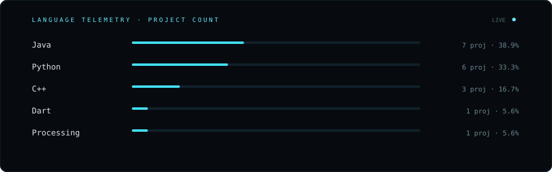

<div align="center">



<br>



<br><br>

<a href="https://www.linkedin.com/in/ioannis-bourmpoulas-81a981373/">
  
</a>
<a href="https://github.com/JohnBourmpoulas">
  
</a>

</div>

## `> about_me.ts`

```ts
const ioannis = {
  education: {
    university: "University of the Aegean",
    department: "Information & Communication Systems Engineering"
  },

  interests: [
    "Software Development",
    "Robotics & Autonomous Systems",
    "Artificial Intelligence",
    "Computer Vision",
    "Embedded Systems",
    "3D Modeling & 3D Printing"
  ],

  about:
    "I enjoy building projects, exploring new technologies, and continuously improving my technical skills."
};
```

## `> core_stack`

<div align="center">


</div>

<br>

## `> language_telemetry`

<div align="center">



</div>

<br>

## `> activity_signal`

<div align="center">


</div>

<br>

<div align="center">


</div>
